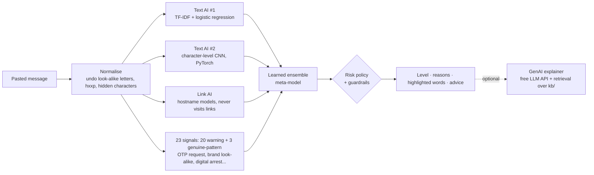

# 🛡️ ScamShield

**AI that tells you, in plain words, whether a text message is a scam, running on IBM LinuxONE.**

Fake KYC alerts, "your parcel is held" fees, "digital arrest" calls, UPI refund tricks: SMS and WhatsApp scams hit elderly people and first-time smartphone users hardest, and once an OTP is shared the money is usually gone. Spam filters say "spam" without saying *why*, and link checkers send your private messages to third parties.

ScamShield takes a pasted message and returns, in milliseconds:

1. **A risk level:** ⛔ HIGH / ⚠️ MEDIUM / ✅ LOW, shown with icon and words, never colour alone.
2. **Reasons a non-technical person understands**, e.g. *"The link pretends to be SBI, but the real website is sbi-kyc-update.top."*
3. **The words the AI found suspicious**, highlighted in the message.
4. **What to do**, including the national cyber-crime helpline.
5. **An optional GenAI explanation** in simple English, grounded in a curated safety knowledge base.

Built for the **IBM Z Datathon 2026** ("AI for Good"). Track: *[confirm on the submission form]*.

---

## How it works



| AI component | Why it's there |
|---|---|
| **TF-IDF + logistic regression** | Fast, strong on short texts, and its weights explain which words matter |
| **Character-level CNN** (100k parameters, trained from scratch) | Reads raw characters, so obfuscation like "0TP", "S B I" or odd spellings doesn't fool it; no tokenizer or pretrained-weight download |
| **Link AI** (gradient boosting on 18 lexical features + char n-gram model) | Scores *hostnames only* and never opens the link: safe and private |
| **Learned ensemble** | A meta-model learns from held-out data how much to trust each model and each signal |
| **Guardrails** | 5 critical patterns (asking for your OTP, UPI PIN "to receive" money, look-alike bank domain, "digital arrest", remote-access apps) always give HIGH |
| **Explainability** | Word-level occlusion shows which words drove the score; signal reasons are written for laypeople |
| **GenAI explainer** (optional) | Any OpenAI-compatible free API (e.g. Groq, Gemini). Retrieves relevant safety cards (BM25), explains the verdict but **cannot change it**, output is validated, and it falls back to a built-in explanation |

## Results

Measured **on the IBM LinuxONE server** (s390x, IBM z17, 3 vCPU / 8 GB, big-endian). The models were also **trained there**. Source files: `reports/metrics_s390x.md`, `reports/bench_s390x.json`, logs in `docs/evidence/`.

| Test set | ScamShield PR-AUC | Rules-only baseline | Scams caught (HIGH) | False alarms (HIGH) |
|---|---|---|---|---|
| Held-out public SMS data (n=916) | **0.987** | 0.357 | 96.9% | 0.5% |
| Unseen Indian-context templates (n=461) | **0.997** | 0.936 | 100% | 6.2% |

- **Honest context:** on the public SMS data, the full system (0.987) is on par with a plain TF-IDF model (0.988). The ensemble's benefit shows on the Indian-context set (0.997 vs 0.967 for TF-IDF alone).
- **Genuine bank messages:** 4.5% of genuine OTP and debit/credit alerts (6 of 132) were rated HIGH on the main split. Re-running the test under five different template splits gave a mean of 0.6% (range 0-3.1%), so treat the real rate as a few percent, not zero. The neural model seems to be the main source of the extra false alarms.
- Link AI on 33,373 never-seen domains: PR-AUC 0.920. Cross-source test (n=945): 0.988, no drop, though Naive Bayes scores the same (0.991).
- Adversarial regression set: 34 of 36. The two misses are a genuine UPI payment confirmation and an insurance-renewal reminder, both rated HIGH.
- **Speed on s390x:** median 2.4 ms per message (p95 6.1 ms), about 340 messages/s on one thread and 600/s in batches. With word-level explanations the median is 3.0 ms (p95 53 ms). Load test on s390x, 10,000 new messages, two runs: about 590 to 600 messages per second with one worker process and about 1,015 to 1,025 with two. A third worker did not help reliably (610 and 870 in the two runs) on this 3-vCPU VM, which also runs the web app. Results vary between runs because the VM is shared (`reports/loadtest_s390x*.json`).
- **74 of 74 tests pass on s390x.** Training the whole system on the 3-vCPU VM takes about 11 minutes.

Full details, confidence intervals and known failure modes: [`docs/MODEL_CARD.md`](docs/MODEL_CARD.md).

## Quick start

### On IBM LinuxONE (the official path)
See [`docs/LINUXONE.md`](docs/LINUXONE.md) for getting a server. Then:

```bash
git clone https://github.com/Danielraj5605/ScamShield.git scamshield && cd scamshield
make setup data train eval test bench serve     # all training and evaluation happen on s390x
ssh -L 8000:127.0.0.1:8000 l1cc                 # from your laptop, then open http://127.0.0.1:8000
```

### On a laptop (development)
```bash
python -m venv .venv && . .venv/bin/activate        # Windows: .venv\Scripts\activate
pip install -r requirements.txt torch
sh scripts/download_data.sh                          # or download the three zips listed in docs/DATA_CARD.md
export PYTHONPATH=src                                # Windows PowerShell: $env:PYTHONPATH="src"
python -m scamshield data && python -m scamshield train && python -m scamshield eval
python -m pytest -q
python -m scamshield serve                           # http://127.0.0.1:8000
python -m scamshield analyze "Your KYC expires today, update at sbi-kyc.top"
```

### Extra commands
```bash
python -m scamshield loadtest --n 10000 --workers 1,2,3   # throughput across worker processes, run it on the server
python -m scamshield blind path/to/messages.csv           # score a hand-collected blind set (see docs/BLIND_SET_GUIDE.md)
python -m scamshield analyze "message text" --explain     # one message from the command line
```

### Optional: GenAI explanations (free)
Create a free API key with any OpenAI-compatible provider, then set these in `.env`:
```dotenv
SS_LLM_BASE_URL=https://api.groq.com/openai/v1
SS_LLM_API_KEY=<your key>
SS_LLM_MODEL=llama-3.1-8b-instant
```
Leave them blank and ScamShield uses its built-in explanations. Nothing is downloaded or run locally. `python -m scamshield eval --llm-judge 200` compares a zero-shot LLM against ScamShield on the same test messages.

## API

| Method | Path | Purpose |
|---|---|---|
| POST | `/api/analyze` | `{"text": "...", "lang": "en"\|"hi"}` → level, score, scam type, reasons, advice, highlights, signals |
| POST | `/api/explain` | Same input → GenAI (or template) explanation |
| POST | `/api/feedback` | Opt-in 👍/👎; stores a salted hash only |
| GET | `/api/health` | Architecture, model version, neural/GenAI status |
| GET | `/api/metrics` | Request count, p50/p95/p99 latency, level distribution |

## Feature status

| Feature | Status |
|---|---|
| Text AI (TF-IDF+LR), neural CNN, link AI, ensemble, guardrails | ✅ implemented and tested |
| Word-level explanations, reasons, advice (English) | ✅ implemented and tested |
| Web UI (black and green, chat-style checker card, self-hosted fonts, phone layout), How it works, Privacy and Terms pages, favicon | ✅ implemented and checked in Chrome at desktop and phone widths |
| Public launch (custom domain, HTTPS, production server, legal review) | ⏳ not done; see [`docs/LAUNCH_CHECKLIST.md`](docs/LAUNCH_CHECKLIST.md) |
| GenAI explainer with retrieval and validation | ✅ implemented; tested against a fake API. Real-API run pending a key |
| Zero-shot LLM comparison in evaluation | ✅ implemented; needs an API key to run |
| LinuxONE (s390x) training, evaluation, tests and benchmark | ✅ done on an IBM z17 VM (evidence in `docs/evidence/`) |
| Regional-language scripts, image/screenshot input, WhatsApp bot | 🗺️ roadmap |

## Limitations
- English only. Public training data is dated (2012 UK/Singapore SMS), so Indian-context coverage comes from our own synthetic templates.
- Genuine messages in unfamiliar styles can be over-flagged (for example a housing-society notice or a UPI payment receipt), and novel scam scripts without warning signs can be missed.
- Advisory only: it never blocks anything, and it can be wrong.

## Responsible AI and privacy
Messages are never stored or logged. Links are never visited. The LLM, if enabled, sees only scrubbed text and can't change the verdict. See [`docs/THREAT_MODEL.md`](docs/THREAT_MODEL.md).

## Repository map
```
src/scamshield/   normalize, urls, signals, features, models/, ensemble, pipeline, genai, api, train, evaluate, bench
data/templates/   synthetic Indian-context templates (committed); raw/processed data is downloaded/generated
kb/               safety knowledge base used by the GenAI explainer
web/              accessible single-page UI
tests/            74 tests incl. privacy, API, fake-LLM, demo messages; adversarial set
reports/          metrics and benchmarks per architecture
docs/             LINUXONE.md, PITCH_SCRIPT.md, ScamShield_Pitch_Deck.pptx, BLIND_SET_GUIDE.md, USER_TEST_GUIDE.md, LAUNCH_CHECKLIST.md, DATA_CARD.md, MODEL_CARD.md, THREAT_MODEL.md, IMPLEMENTATION_PLAN.md, ScamShield_Abstract.pdf, evidence/
```

## Credits
Datasets: UCI SMS Spam Collection, Mendeley SMS Phishing Dataset, PhiUSIIL Phishing URL Dataset (all CC BY 4.0). See [`NOTICE`](NOTICE).

Report cyber fraud in India: **1930** · cybercrime.gov.in
