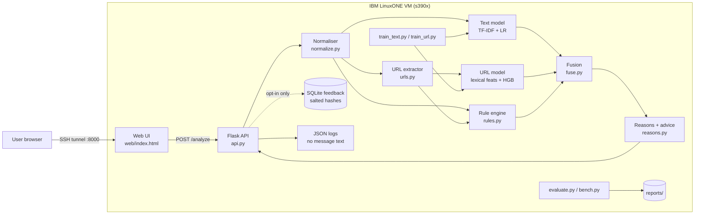

# ScamShield — Step-by-Step Implementation Plan

> **Companion to:** `IBM_DATATHON_2026_ACTION_PLAN.md` (§4 P2 concept, §6.2 blueprint). This file turns that blueprint into an executable build plan.
> **Prepared:** 2026-10-17. **Target:** a working prototype on the team's IBM LinuxONE Community Cloud VM (s390x, 3 vCPU / 8 GB) within the 24-hour Datathon window.
> **Status of this document:** plan only. No code has been written yet. Snippets below are reference designs to implement and test, not finished code.

> [!IMPORTANT]
> ScamShield is **our own project concept**, not an organiser-provided problem statement. It is designed to fit the fraud/real-time track or the wildcard track. Confirm the official track names in the Hack2Skill guidebook before you select one on the submission form.

---

## 0. Implementation Status and Design Changes (updated 2026-10-17)

> **This section supersedes the rest of the document wherever they differ.** The code lives in `scamshield/`. Its `README.md` and `docs/` describe the system as built.

### 0.1 Status

| Phase (§10) | Status |
|---|---|
| 0: Repo skeleton, API contract | ✅ Done (`scamshield/`; git not initialised yet: waiting for the team's GitHub repo) |
| 1: Platform ready on LinuxONE | ✅ **Done.** IBM z17 VM (`s390x`, big-endian, 3 vCPU, 7.8 GiB, Ubuntu 24.04.5); SSH access works |
| 2: Data | ✅ Done: D1-D3 downloaded with checksums (on the server too); D4 = 58 scam + 86 genuine templates (English only) |
| 3: NLP utilities + signals | ✅ Done (23 signals: 20 warning + 3 genuine-pattern) |
| 4: Models | ✅ Done, **trained on s390x** (about 11 min) |
| 5: Ensemble, reasons, API | ✅ Done (ensemble trained on group-out-of-fold predictions) |
| 6: UI | ✅ Done (manual accessibility check pending) |
| 7: Evaluation + benchmark | ✅ **Done on s390x** → `scamshield/reports/*_s390x.*`, logs in `scamshield/docs/evidence/` |
| 8: Docs, demo, pitch | 🟡 README, LINUXONE, DATA_CARD, MODEL_CARD, THREAT_MODEL and abstract PDF done and updated with s390x numbers; **deck, demo video, screenshots pending** |
| 9: Submit | ⏳ Pending |
| Tests | ✅ 48/48 pass on s390x |

### 0.2 Design changes from the original plan

| Area | Original plan | As built | Why |
|---|---|---|---|
| AI scope | TF-IDF+LR text model, URL HGB, rules | **AI-first stack:** TF-IDF+LR, **character-level CNN (PyTorch, trained from scratch)**, two hostname models, **learned meta-model ensemble**, **word-level occlusion explanations**, scam-type classifier, **GenAI explainer with RAG** | Team asked for a mostly-AI project, entirely free |
| Language | English + Hinglish | **English only** | Team decision: Hindi/Hinglish not needed |
| Signals | Hand-weighted rules | 23 signals are **features the ensemble learns to weigh**, user-facing reasons, and 5 CRITICAL guardrails; 3 of them are "looks genuine" patterns (OTP notice, bank transaction notice, all links official) | Lets the AI decide; keeps hard safety stops; cuts false alarms on genuine bank messages |
| Fusion | Noisy-OR + rule boost | Logistic-regression meta-model trained on **group-out-of-fold predictions** (all messages of a template in the same fold) over train+val; thresholds from grouped CV; MEDIUM band kept; corroboration rule | Training it on the small validation split over-flagged unfamiliar genuine messages (multi-split false alarms about 17%, now about 1.5%) |
| LLM | None | **Free hosted OpenAI-compatible API** (e.g. Groq/Gemini free tier) configured in `.env`; no local LLM downloads. Explains only, never decides; receives scrubbed text only; output validated; template fallback | Team decision: free API only |
| URL model | Full-URL features | **Hostname only** + char n-gram model + official-domain allowlist | PhiUSIIL legit URLs are all bare homepages, so full URLs leak the label |
| PhiUSIIL labels | verify | **Verified: `label=1` = legitimate, `0` = phishing** | resolved |
| Mendeley dataset | Train source | CC BY 4.0 confirmed; about 5,000 of 5,971 rows duplicate UCI, so only **945 unique** rows are used (cross-source test) | resolved |
| Entry point | Makefile only | `python -m scamshield <data/train/eval/serve/bench/evidence/analyze/all>`; Makefile wraps it | Works on Windows and s390x |

### 0.3 Results on LinuxONE (s390x)

| Test set | ScamShield PR-AUC | Rules-only | Recall (HIGH) | False alarms (HIGH) |
|---|---|---|---|---|
| test_in (n=916) | 0.987 | 0.357 | 96.9% | 0.5% |
| test_india (n=461) | 0.997 | 0.926 | 100% | 6.6% |

- On public SMS data the ensemble is **not** better than plain TF-IDF (0.987 vs 0.988); its gain appears on the Indian-context set (0.997 vs 0.967).
- Genuine OTP/bank alerts rated HIGH: 5.3% (7 of 132) on the main split; mean 1.2% (0-2.3%) across 5 template splits. The earlier "0 of 132" claim came from a lucky split and has been retracted.
- Link AI PR-AUC 0.920 (33,373 unseen domains); cross-source 0.988 (n=945); adversarial 34/36.
- Speed: median 2.7 ms per message (p95 8.5 ms), about 250 msg/s single-threaded, 410 msg/s batched.
- Templates for genuine refund, bill and debit styles were added after examining errors, so the Indian-context numbers are not a clean blind test.

### 0.4 What is still needed
1. **Create an empty GitHub repo** (no README or licence) and share the URL, so git can be initialised and pushed. Pick a licence (MIT or Apache-2.0).
2. **Record the demo evidence on the server:** start `make serve`, open the SSH tunnel, screenshot the UI footer ("Running on IBM LinuxONE (s390x)") beside `uname -m`, and record a 60-90 s screen capture.
3. **Pitch deck and demo video.**
4. (Optional) **A free LLM API key** (Groq or Google AI Studio) for GenAI explanations and the zero-shot LLM comparison. Put it in `.env` on the server, never in git.
5. Confirm the **track** and **exact deadline time** on Hack2Skill.


---

## Table of Contents

1. [What ScamShield Is](#1-what-scamshield-is)
2. [Scope: What We Build and What We Don't](#2-scope-what-we-build-and-what-we-dont)
3. [System Design](#3-system-design)
4. [Data Plan](#4-data-plan)
5. [Model Design](#5-model-design)
6. [Reason and Advice Engine](#6-reason-and-advice-engine)
7. [API Specification](#7-api-specification)
8. [User Interface](#8-user-interface)
9. [Repository Layout and Module Specs](#9-repository-layout-and-module-specs)
10. [Step-by-Step Build Plan (24 Hours)](#10-step-by-step-build-plan-24-hours)
11. [IBM LinuxONE Deployment and Evidence](#11-ibm-linuxone-deployment-and-evidence)
12. [Testing and Evaluation Plan](#12-testing-and-evaluation-plan)
13. [Security, Privacy and Responsible AI](#13-security-privacy-and-responsible-ai)
14. [Team Roles and Ownership](#14-team-roles-and-ownership)
15. [Demo Script](#15-demo-script)
16. [Risks and Fallbacks](#16-risks-and-fallbacks)
17. [Definition of Done](#17-definition-of-done)
18. [Open Items to Verify](#18-open-items-to-verify)

---

## 1. What ScamShield Is

### 1.1 The problem
Fraudsters send SMS and WhatsApp messages impersonating banks, couriers, electricity boards, employers and police. Common lures include:

- "Your KYC expires today, click here"
- "Your parcel is held, pay ₹25"
- "Part-time job, earn ₹5,000/day"
- "Your electricity will be disconnected tonight"
- "This is the cyber police, you are under digital arrest"

The victims are disproportionately **elderly people, first-time smartphone users and people with low digital literacy**. Once they share an OTP or approve a UPI payment, the money is usually gone.

### 1.2 Why existing tools fall short
- **Carrier spam filters** label messages "spam" without saying *why*. A label doesn't teach anyone anything, and a false alarm on a genuine bank message breeds distrust.
- **Link checkers** usually send the URL, and sometimes the whole message, to a third-party cloud service. That leaks private conversations.
- **Awareness campaigns** are generic. A person holding a suspicious message at 11 p.m. has nobody to ask.

### 1.3 What ScamShield does
A user (or a family member helping them) pastes a suspicious message. ScamShield returns, in under a second:

1. **A risk level:** HIGH / MEDIUM / LOW, shown with colour, an icon and words, never colour alone.
2. **Plain-language reasons** a non-technical person understands. For example: "It asks you to share an OTP. Banks never ask for this." or "The link looks like 'sbi' but the real website is `sbi-kyc-update.top`."
3. **A concrete action.** For example: "Do not click. Call your bank on the number printed on your card." or "Report it at 1930 / cybercrime.gov.in." (Verify the helpline details before the demo; see §18.)
4. **Scam type**, when recognised (KYC, parcel, job, utility, impersonation, prize, refund, loan, investment).

### 1.4 How it works (one paragraph)
The message is normalised: Unicode folded, look-alike characters mapped, links defanged. Two independent models score it:
- a **text classifier** (TF-IDF word + character n-grams → logistic regression), which judges the *language*;
- a **URL classifier** (lexical features → gradient boosting), which judges each *link* **without ever visiting it**.

A transparent **rule layer** detects high-signal patterns, such as a request to share an OTP, a look-alike bank domain or a call-back number. A **fusion step** combines the model scores and rule hits into the final risk level. Reasons come from the rule hits and the most influential words. Everything runs on IBM LinuxONE, and by default **nothing the user pastes is stored**.

### 1.5 Why it belongs on IBM LinuxONE
The realistic deployment is **provider-side**: a bank, telecom operator or government helpline scanning very large message volumes, where the content is highly sensitive. The pitch is that sensitive message content is scored on a secure, high-throughput platform without leaving it for third-party clouds.

**Be honest in the pitch.** In this prototype we *demonstrate* the workload running on s390x and *measure* throughput and latency there. We do not claim bank-scale results. The platform's encryption and AI-accelerator features are **not** used unless we actually enable and measure them.

### 1.6 Who benefits

| Persona | Need | What ScamShield gives them |
|---|---|---|
| **Kamala, 68**, retired teacher, uses WhatsApp and UPI | "Is this message from my bank real?" | A clear yes/no-style answer, with a reason she can repeat to her son |
| **Arjun, 24**, helps parents with phones | Explain *why* something is a scam | Shareable reasons and advice |
| **Bank/telecom anti-fraud analyst** (future) | Bulk triage of reported messages | An API, a scam-type taxonomy and throughput on Z |

*Personas are illustrative and must be labelled as such in the pitch.*

---

## 2. Scope: What We Build and What We Don't

### 2.1 MoSCoW scope (24 h)

| Priority | Feature | Gate |
|---|---|---|
| **Must** | Text model (TF-IDF + LR) trained **on s390x** | H+6 |
| **Must** | URL model (lexical features + HGB) trained on s390x | H+8 |
| **Must** | Rule layer: OTP request, urgency, brand look-alike, shortener, call-back number, UPI collect | H+8 |
| **Must** | Fusion → risk level, reasons, advice, scam type | H+10 |
| **Must** | `POST /analyze` API + accessible single-page UI | H+10 |
| **Must** | Evaluation report: in-distribution, cross-source and adversarial sets | H+14 |
| **Must** | Latency/throughput benchmark on s390x, plus the evidence pack | H+14 |
| **Should** | Synthetic Indian-context test set (held-out templates) | H+12 |
| **Should** | Hinglish/transliterated keyword rules ("turant", "khata band", "inaam") | H+12 |
| **Should** | Privacy mode by default; opt-in feedback stored as a salted hash only | H+12 |
| **Could** | "Read aloud" button (browser Web Speech API, client-side only) | if ahead |
| **Could** | Hindi advice text | if ahead |
| **Could** | Batch endpoint `/analyze/batch` for the analyst story | if ahead |
| **Won't (this event)** | Fetching or visiting URLs, WhatsApp/SMS integration, mobile app, LLMs, image/screenshot OCR | — |

### 2.2 Explicit non-goals
- **Not a blocker.** ScamShield only advises; it never deletes or blocks a message.
- **Not a guarantee.** The UI always says "This is an automated check and can be wrong."
- **No live link fetching.** Visiting scam links is a safety and ethics risk, and adds latency.

---

## 3. System Design

### 3.1 Architecture



### 3.2 Request flow (happy path)
1. The UI sends `{"text": "..."}`; the server rejects anything over 2,000 characters.
2. `normalize()` applies NFKC, lower-cases into a *copy* (the original is kept for display), maps confusables (Cyrillic `а` → Latin `a`), re-fangs `hxxp` / `[.]`, and collapses whitespace.
3. `extract_urls()` finds URLs and bare domains (`sbi-kyc.top`, `bit.ly/abc`).
4. **Text model:** `p_text = P(suspicious | text)`.
5. **URL model:** `p_url = max over URLs of P(phishing | url)`; `None` if the message has no URLs.
6. **Rules:** a list of `RuleHit(id, weight, reason_key, scam_type)`.
7. **Fusion:** a risk score in [0, 1], then the level.
8. **Reasons and advice:** the top 3 reasons (rules first, then influential n-grams), plus advice for the detected scam type.
9. **Response:** JSON with level, score, reasons, advice, scam type, model version and latency.

### 3.3 Technology choices

| Choice | Why | s390x risk |
|---|---|---|
| Python 3.10+ | Team skill; ecosystem | None (system Python) |
| scikit-learn | TF-IDF, LR, HGB, calibration; no GPU needed | Low. Preinstalled on the L1CC image according to the 2025 winner, or available via `apt python3-sklearn` |
| Flask | Pure Python; zero wheel risk | None |
| joblib | Model persistence | Low. **Train on s390x anyway** (big-endian safety) |
| SQLite | Built in; only used for opt-in feedback | None |
| Plain HTML/CSS/JS | No build step, accessible, fast | None |
| pytest | Tests | None |
| **Avoided:** `tldextract` | Downloads a suffix list at runtime (network dependency) | Replaced by a bundled small suffix list |
| **Avoided:** SHAP, spaCy, transformers | Heavy native dependencies, s390x build risk, unneeded | — |

---

## 4. Data Plan

### 4.1 Sources

| ID | Dataset | Content | Size | Licence | Use |
|---|---|---|---|---|---|
| D1 | **UCI SMS Spam Collection** — https://archive.ics.uci.edu/dataset/228/sms+spam+collection | SMS labelled ham/spam (UK/Singapore, ~2012) | 5,574 msgs | CC BY 4.0 | Text model train/test |
| D2 | **Mendeley SMS Phishing Dataset** (Mishra & Soni) — https://data.mendeley.com/datasets/f45bkkt8pr/1 | SMS labelled ham / spam / smishing | ~5,971 msgs | **Verify** on the page (believed CC BY 4.0) | Text model train; **cross-source test** |
| D3 | **PhiUSIIL Phishing URL Dataset** — https://archive.ics.uci.edu/dataset/967/phiusiil+phishing+url+dataset | URLs labelled phishing/legitimate, plus page-derived features | ~235k URLs | CC BY 4.0 | URL model. **Use only the raw `URL` string column.** Do not use page-content features; we never fetch pages. |
| D4 | **ScamShield synthetic Indian-context set** (created by us) | Templated scam *and* legitimate messages in the Indian context | ~600–1,000 msgs | Ours (publish under the repo licence) | Gap filler for training + **held-out-template test** |

> **Check the label encodings before training.** For PhiUSIIL, confirm which value of `label` means phishing; it is commonly documented as `1 = legitimate`, `0 = phishing`, but **verify against the dataset page and the data itself**, e.g. by inspecting known brand domains. For D2, confirm the column names and label strings.

### 4.2 The critical data gap, and how we close it
Public "ham" messages are mostly personal chat ("ok see u at 5"). They contain almost **no legitimate transactional messages**: bank OTPs, debit alerts, delivery updates. A model trained only on D1 and D2 will learn that "formal message mentioning a bank or OTP = scam". It would then **flag genuine bank SMS as HIGH**, which destroys user trust and fails our own demo.

**Fix: D4 must include both sides.**
- **Legit transactional templates (~50%):**
  - "{OTP} is your OTP for txn of Rs {amt} at {merchant}. Do not share it with anyone. -{BANK}"
  - "Rs {amt} debited from A/c XX{last4} on {date}. Not you? Call {official_number}"
  - "Your order {id} is out for delivery."
- **Scam templates (~50%) across 9 types:** KYC, parcel, job/task, utility disconnection, impersonation/"digital arrest", prize/lottery, refund/UPI collect, instant loan, investment/crypto.

**Template hygiene:**
- Each template has an ID.
- Split **by template ID**, never by generated message: 70% of template IDs go to training, 30% are **held out** for testing. Otherwise the test set leaks from training and inflates the scores.
- Fill slots from small lists of brands, amounts, names, cities, fake domains (`.top`, `.xyz`, `-verify.in` look-alikes) and phone numbers. Use only obviously fake numbers and domains (e.g. `example`-style or clearly reserved patterns), never real people's numbers.
- Write templates from **public awareness advisories** (bank and government cyber-safety pages) in our own words. Do not copy real victims' messages containing personal data.
- Mark every D4 row with `source=synthetic` and say so in `DATA_CARD.md` and in the pitch.

### 4.3 Unified schema
All text sources are converted to one CSV/Parquet-free format, a plain CSV, to avoid needing pyarrow on s390x:

```
data/processed/messages.csv
  msg_id      str   stable ID (source prefix + row/template)
  text        str   original message
  label       int   1 = suspicious (spam or smishing/scam), 0 = legitimate
  sublabel    str   ham | spam | smishing | scam:<type> | legit:<type>
  source      str   uci_sms | mendeley | synthetic
  template_id str   synthetic only (else empty)
  split       str   train | val | test   (assigned by make_splits.py)

data/processed/urls.csv
  url    str
  label  int  1 = phishing, 0 = legitimate   (after verifying the original encoding)
  split  str
```

**Label policy:** promotional spam counts as `label=1` for the text model, but the fusion step caps it at **MEDIUM** unless a scam-type rule or a phishing URL fires (see §5.3). This separates "annoying" from "dangerous".

### 4.4 Splits

| Set | Construction | Purpose |
|---|---|---|
| `train` / `val` | Stratified 80/20 of D1 + D2-train + D4-train-templates; `random_state=42` | Fit + calibrate + choose thresholds |
| `test_in` | Stratified 15% hold-out from D1 + D2, taken **before** the train/val split | In-distribution performance |
| `test_cross` | Train **without** D2, test on D2 (separate experiment) | Shows the domain-shift drop honestly |
| `test_india` | D4 held-out templates (30% of template IDs) | Indian-context generalisation |
| `test_adv` | ~40 hand-written adversarial messages (§12.3) | Robustness |
| URLs | Stratified 70/15/15 of D3; deduplicate by registered domain *before* splitting so the same domain is never in train and test | URL model |

### 4.5 Data steps
1. `scripts/download_data.sh` downloads D1–D3 into `data/raw/` and prints SHA-256 checksums, which are recorded in `DATA_CARD.md`. If a site needs a manual click (e.g. Mendeley), download locally and `scp` to the server.
2. `src/scamshield/data.py` loads each source, validates columns, maps labels, deduplicates (exact and near-duplicate via normalised text) and writes `data/processed/messages.csv`.
3. `src/scamshield/synth.py` generates D4 from `data/templates/*.yaml` with a fixed seed.
4. `src/scamshield/make_splits.py` assigns splits as in §4.4.
5. A sanity report prints counts per source × label × split; check class balance.

---

## 5. Model Design

### 5.1 Text model
```text
Pipeline:
  FeatureUnion(
    TfidfVectorizer(analyzer="word", ngram_range=(1,2), min_df=2, max_features=50_000, sublinear_tf=True),
    TfidfVectorizer(analyzer="char_wb", ngram_range=(3,5), min_df=3, max_features=100_000, sublinear_tf=True)
  )
  -> LogisticRegression(C tuned on val in {0.5,1,2,4}, class_weight="balanced", max_iter=2000)
  -> CalibratedClassifierCV(method="sigmoid", cv="prefit") on val   # well-behaved probabilities for fusion
```

- **Pre-processing before vectorising:** replace URLs with the token `__url__`, numbers with `__num__`, currency amounts with `__amt__` and phone numbers with `__phone__`. The model then learns patterns, not specific numbers.
- **Why LR:** fast on CPU, tiny latency, and per-token coefficients double as explanations.
- **Baselines to report:**
  - **B0:** keyword rules only.
  - **B1:** multinomial Naive Bayes on word TF-IDF.
  - Compare against the main model on every test set.

### 5.2 URL model
Lexical features computed from the URL string only (`url_features.py`):

| Group | Features |
|---|---|
| Size | `len_url`, `len_host`, `len_path`, `n_subdomains`, `n_path_segments` |
| Characters | `n_digits`, `digit_ratio`, `n_hyphens`, `n_dots`, `n_at`, `n_query_params`, `has_port` |
| Host | `is_ip_host`, `has_punycode` (`xn--`), `tld_suspicious` (bundled list, e.g. `top, xyz, buzz, click, live, icu`; verify against public phishing statistics), `is_shortener` (bit.ly, tinyurl, …) |
| Randomness | `host_entropy` (Shannon), `longest_digit_run`, `vowel_ratio_host` |
| Brand abuse | `brand_in_host_not_registered` (brand string appears in a subdomain or path but the registered domain differs), `min_edit_distance_to_brand` (Levenshtein to brand list: sbi, hdfcbank, icicibank, axisbank, paytm, phonepe, amazon, flipkart, indiapost, …) |
| Keywords | `kw_login`, `kw_verify`, `kw_kyc`, `kw_update`, `kw_secure`, `kw_refund` in host/path |
| Scheme | `is_https` (weak signal: most phishing uses HTTPS now) |

Model: `HistGradientBoostingClassifier(max_iter=300, learning_rate=0.1, early_stopping=True, class_weight="balanced")` + sigmoid calibration on val. Baseline: LR on the same features.

> **Guard against leakage:** PhiUSIIL legitimate URLs are mostly popular site homepages, while phishing URLs are long paths. A model can score highly just by learning "has a path = phishing". Mitigate and report:
> 1. Deduplicate by domain before splitting.
> 2. Include a **path-only ablation** in the report.
> 3. Test on D4's URLs, which include legitimate deep links like `https://www.sbi.co.in/web/personal-banking/...`. Verify the real URL format before using it.
>
> If D4 legitimate deep links score high, say so and lean on rules.

### 5.3 Fusion
Phase 1 (default, transparent):

```text
p_model = 1 - (1 - p_text) * (1 - p_url)      # noisy-OR; p_url = 0 if no URL
rule_boost = min(0.5, sum(hit.weight for hit in rule_hits))
risk = clip(p_model + rule_boost * (1 - p_model), 0, 1)

level:
  HIGH   if risk >= T_high  OR any CRITICAL rule (OTP/PIN/CVV share request, brand look-alike domain, "digital arrest")
  MEDIUM if risk >= T_med
  LOW    otherwise
Promotional cap: if text model says spam but no scam rule fired and p_url < 0.5 -> at most MEDIUM
Safe-pattern dampener: legit OTP pattern ("do not share") with no URL and no call-to-action -> at most LOW unless a CRITICAL rule fires
```

- Choose `T_high` and `T_med` on the validation set:
  - `T_high`: precision for suspicious messages ≥ 0.95.
  - `T_med`: recall ≥ 0.95.
- Write both thresholds to `models/model_meta.json`.
- Phase 2 (optional, only if time allows): replace the formula with a small logistic stacker trained on validation outputs. **Keep Phase 1 if the stacker doesn't beat it on `test_india`.**

### 5.4 Artifacts
```
models/text_model.joblib
models/url_model.joblib
models/model_meta.json   # committed
  {"version": "ss-2026-10-17-<gitsha7>", "trained_on_arch": "s390x", "python": "...",
   "sklearn": "...", "thresholds": {"high": 0.xx, "med": 0.xx},
   "data_checksums": {...}, "seed": 42}
```

The API refuses to start if `trained_on_arch != platform.machine()`, unless `SS_ALLOW_ARCH_MISMATCH=1` is set. This is the safeguard against the big-endian artifact problem.

---

## 6. Reason and Advice Engine

### 6.1 Rule catalogue (`rules.py`)
Each rule has an ID, a regex or function, a weight, a severity, a reason key and an optional scam type. All patterns run on the **normalised** text.

| ID | Detects | Example pattern idea | Severity | Weight | Reason (English, user-facing) |
|---|---|---|---|---|---|
| R01 | Request to **share** OTP/PIN/CVV/password | `(share|send|tell|forward|give).{0,20}(otp|pin|cvv|password)` **and not** `(do not|don't|never).{0,10}share` | CRITICAL | 0.5 | "It asks you to share a secret code (OTP/PIN). Banks never ask for this." |
| R02 | Account blocked/suspended/KYC expiry | `(account|a/c|kyc|pan|aadhaar).{0,30}(block|suspend|expire|deactivat|update)` | HIGH | 0.25 | "It threatens to block your account to rush you." |
| R03 | Urgency | `(urgent|immediately|within \d+ (min|hour)|today only|last chance|turant|abhi)` | MED | 0.1 | "It tries to make you act fast without thinking." |
| R04 | Brand look-alike domain | from URL features: brand in host but registered domain ≠ official list | CRITICAL | 0.5 | "The link pretends to be {brand}, but the real site is {domain}." |
| R05 | Link shortener | host in shortener list | MED | 0.1 | "The link is hidden behind a short link, so you can't see where it goes." |
| R06 | Call-back to unknown number | `(call|contact|whatsapp).{0,15}__phone__` with a scam context word | HIGH | 0.2 | "It asks you to call a number. Scammers use this to talk you into paying." |
| R07 | UPI collect / "receive money" trick | `(collect request|approve.{0,10}(request|payment)|enter (upi )?pin to receive)` | CRITICAL | 0.5 | "You never need to enter your UPI PIN to *receive* money." |
| R08 | Prize/lottery/refund | `(won|winner|lottery|prize|cashback|refund|inaam)` | HIGH | 0.2 | "It promises money you didn't expect." |
| R09 | Job/task scam | `(part[- ]time|work from home|earn).{0,30}(per day|daily|/day)` | HIGH | 0.2 | "Easy-money job offers are a common scam." |
| R10 | Utility disconnection | `(electricity|power|bijli).{0,30}(disconnect|cut)` | HIGH | 0.25 | "It threatens to cut your electricity tonight." |
| R11 | Impersonation / "digital arrest" | `(police|cbi|customs|court|cyber cell|digital arrest|narcotics)` + threat word | CRITICAL | 0.5 | "Police and courts never arrest or fine anyone over a message or video call." |
| R12 | Parcel/delivery fee | `(parcel|courier|shipment|package).{0,40}(held|pending|fee|pay)` | HIGH | 0.2 | "It asks for a small fee to release a parcel, a common trick." |
| R13 | Remote-access app | `(anydesk|teamviewer|quicksupport|screen share|apk)` | CRITICAL | 0.5 | "It asks you to install an app that lets strangers control your phone." |
| S01 | **Safe** legit OTP notification | `otp.{0,60}(do not|don't|never) share` and no URL and no R06 | SAFE | −0.3 | (no reason shown; dampener) |

Rules are reviewed by two team members for false-positive risk before H+10. Each one has at least one positive and one negative unit test.

### 6.2 Model-derived reasons
When fewer than 3 rule reasons fire, add up to 2 reasons from the text model: the top positive contributions `coef_j × tfidf_j` in the message. Map these to friendly text: "Contains words often used in scams: 'verify', 'blocked', 'click'." Show only **word** n-grams; character n-grams are not human-readable.

### 6.3 Advice table (`advice.py`)

| Scam type | Advice (example wording; review for accuracy) |
|---|---|
| default HIGH | "Do not click links, call numbers or share codes from this message. If unsure, contact your bank using the number on your card or official app." |
| kyc / account | "Banks do not block accounts over SMS. Open your bank's official app or visit a branch." |
| otp / upi | "Never share an OTP or UPI PIN. You never need a PIN to receive money." |
| impersonation | "Hang up. Police and courts do not demand money by phone or video call." |
| job | "Real employers don't ask you to pay or do 'tasks' for money upfront." |
| parcel | "Check your order only on the official courier or shop website." |
| report (all HIGH) | "Report it: National Cyber Crime Helpline 1930 or cybercrime.gov.in." (**Verify before the demo**, §18.) |
| MEDIUM | "Be careful. Don't share personal details or click links unless you're sure who sent it." |
| LOW | "We didn't find common scam signs, but stay alert. When in doubt, ask someone you trust." |

---

## 7. API Specification

Base URL: `http://127.0.0.1:8000` (bound to localhost; reach it through an SSH tunnel).

### `POST /analyze`
Request:
```json
{"text": "Dear customer your SBI KYC expires today. Update now: http://sbi-kyc-update.top/login or account will be blocked", "lang": "en"}
```
Constraints:
- `text` is required, 1–2000 characters.
- `lang` is optional (`en` or `hi`, for advice text only).
- Content-Type must be `application/json`; the body is capped at 8 KB.

Response `200`:
```json
{
  "risk_level": "HIGH",
  "risk_score": 0.97,
  "scam_type": "kyc",
  "reasons": [
    {"id": "R04", "text": "The link pretends to be SBI, but the real site is sbi-kyc-update.top."},
    {"id": "R02", "text": "It threatens to block your account to rush you."},
    {"id": "R03", "text": "It tries to make you act fast without thinking."}
  ],
  "advice": ["Banks do not block accounts over SMS. Open your bank's official app or visit a branch.",
             "Report it: National Cyber Crime Helpline 1930 or cybercrime.gov.in."],
  "signals": {"p_text": 0.93, "p_url": 0.88, "urls": ["sbi-kyc-update[.]top/login"], "rules": ["R04","R02","R03"]},
  "model_version": "ss-2026-10-17-abc1234",
  "latency_ms": 4.2,
  "disclaimer": "Automated check. It can be wrong."
}
```
- URLs are returned **defanged** (`[.]`) so the UI never renders a clickable scam link.

Errors:
- `400 {"error":"text_required"}`
- `413 {"error":"too_long","max_chars":2000}`
- `415` for a non-JSON body
- `500 {"error":"internal","request_id":"..."}`

### `POST /feedback` (opt-in)
`{"request_id": "...", "verdict": "correct" | "wrong"}`. Stores `sha256(salt + normalised_text)`, the verdict, the model version and a timestamp. **Never the text.** The salt comes from `.env`.

### `GET /health`
`{"status":"ok","arch":"s390x","model_version":"..."}`

### `GET /metrics`
Request count, p50/p95/p99 latency and the risk-level distribution since start.

### `POST /analyze/batch` (Could)
Up to 500 messages; returns a list of results. Used for the analyst-throughput story.

---

## 8. User Interface

A single page, `web/index.html`, served by Flask. No framework and no build step.

**Layout (mobile-first):**
1. Title: "ScamShield: Is this message safe?"
2. A large textarea with the label "Paste the message here" and a character counter.
3. A **"Check message"** button (large; keyboard-accessible; Enter + Ctrl submits).
4. Example buttons: "Fake KYC", "Parcel fee", "Job offer", "Real bank OTP". These fill the textarea for the demo.
5. The **result card**:
   - Big badge: 🔴 **HIGH RISK — Likely a scam** / 🟠 **Be careful** / 🟢 **No common scam signs**. Icon, colour and text together, never colour alone.
   - "Why:" as a bulleted list of reasons.
   - "What to do:" as advice bullets.
   - Defanged links shown as plain text.
   - Disclaimer line.
   - Optional "Was this right? 👍 👎" (opt-in feedback).
   - Optional 🔊 "Read aloud" (Web Speech API in the browser; no server involvement).
6. Footer: "We don't store your message." (true only while privacy mode is the default; keep it true).

**Accessibility checklist:**
- [ ] Base font ≥ 18 px; contrast ≥ 4.5:1
- [ ] All controls reachable and operable by keyboard; visible focus ring
- [ ] Result region uses `aria-live="polite"` so screen readers announce it
- [ ] Inputs have `<label>`s; buttons have text, not only icons
- [ ] Works at 360 px width

---

## 9. Repository Layout and Module Specs

```
scamshield/
├── README.md                    # problem, quickstart (LinuxONE), results, limitations, credits
├── LICENSE                      # e.g. Apache-2.0 (team decision)
├── NOTICE                       # dataset + library attributions
├── .gitignore  .env.example  Makefile
├── requirements.txt             # pinned, s390x-tested
├── requirements-dev.txt         # pytest, ruff
├── configs/
│   ├── default.yaml             # paths, size limits, seeds, threshold targets
│   ├── brands.yaml              # brand -> official registered domains (verify each)
│   ├── shorteners.txt  suspicious_tlds.txt  public_suffixes.txt
├── data/
│   ├── README.md                # how to download, checksums, licences
│   ├── templates/               # synthetic scam + legit templates (committed)
│   ├── raw/  processed/         # gitignored
├── src/scamshield/
│   ├── __init__.py
│   ├── config.py                # load YAML + env
│   ├── normalize.py             # NFKC, confusables, refang, token placeholders
│   ├── urls.py                  # extract + defang + parse host / registered domain
│   ├── url_features.py          # lexical features (§5.2)
│   ├── rules.py                 # rule catalogue (§6.1)
│   ├── data.py  synth.py  make_splits.py
│   ├── train_text.py  train_url.py
│   ├── fuse.py                  # fusion + thresholds + caps/dampeners
│   ├── reasons.py  advice.py
│   ├── evaluate.py              # all test sets -> reports/metrics.json + figures
│   ├── platform_info.py         # arch/CPU/RAM/versions fingerprint
│   └── api.py                   # Flask app
├── scripts/
│   ├── download_data.sh  bench.py  collect_evidence.sh  demo_messages.json
├── web/index.html
├── tests/
│   ├── test_normalize.py  test_urls.py  test_url_features.py  test_rules.py
│   ├── test_fuse.py  test_api.py  test_privacy.py
│   ├── adversarial/adv_messages.json
│   └── e2e/test_demo_messages.py
├── reports/                     # committed outputs: metrics.json, bench_s390x.json, figures/
├── models/                      # gitignored except model_meta.json
└── docs/
    ├── ARCHITECTURE.md  LINUXONE.md  DATA_CARD.md  MODEL_CARD.md  THREAT_MODEL.md
    └── evidence/
```

### 9.1 Key function signatures (contract between team members)

```python
# normalize.py
def normalize(text: str) -> str: ...                       # for models/rules
def placeholderize(text: str) -> str: ...                  # __url__, __num__, __amt__, __phone__

# urls.py
def extract_urls(text: str) -> list[str]: ...              # handles hxxp, [.], bare domains
def registered_domain(host: str) -> str: ...               # via bundled public_suffixes.txt
def defang(url: str) -> str: ...

# url_features.py
FEATURE_NAMES: list[str]
def url_features(url: str) -> list[float]: ...             # order == FEATURE_NAMES

# rules.py
@dataclass(frozen=True)
class RuleHit: id: str; severity: str; weight: float; reason_key: str; scam_type: str | None; detail: dict
def run_rules(norm_text: str, urls: list[str]) -> list[RuleHit]: ...

# fuse.py
@dataclass
class Assessment: level: str; score: float; scam_type: str | None; hits: list[RuleHit]; p_text: float; p_url: float | None
def assess(norm_text: str, urls: list[str], p_text: float, p_url: float | None, hits: list[RuleHit], meta: dict) -> Assessment: ...

# reasons.py / advice.py
def build_reasons(a: Assessment, text_model, norm_text: str, max_n: int = 3) -> list[dict]: ...
def build_advice(a: Assessment, lang: str = "en") -> list[str]: ...
```

### 9.2 Makefile targets (single entry point for teammates and judges)

```makefile
setup:     ## create venv (system site packages), install pinned deps
data:      ## download + process + synth + splits
train:     ## train_text + train_url, write models/ + model_meta.json
eval:      ## evaluate all test sets -> reports/metrics.json
serve:     ## run API on 127.0.0.1:$(SS_PORT)
test:      ## pytest (unit + integration)
e2e:       ## run demo messages against a live server
bench:     ## latency/throughput -> reports/bench_$(ARCH).json
evidence:  ## platform fingerprint, pip freeze, git SHA -> docs/evidence/
all: setup data train eval test bench evidence
```

### 9.3 `.env.example`

```dotenv
SS_HOST=127.0.0.1
SS_PORT=8000
SS_MAX_CHARS=2000
SS_PRIVACY_MODE=1                 # 1 = never store message-derived data except opt-in hashes
SS_FEEDBACK_SALT=change-me        # python3 -c "import secrets;print(secrets.token_hex(16))"
SS_DB_PATH=./feedback.db
SS_LOG_LEVEL=INFO
SS_SEED=42
SS_ALLOW_ARCH_MISMATCH=0
```

---

## 10. Step-by-Step Build Plan (24 Hours)

> **H+0** = when the team starts. Gates in **bold** are hard checkpoints; if a gate is missed, apply its fallback immediately. Owner codes: **PM** (project manager/storyteller), **INF** (infra), **ML**, **BE** (backend), **FE** (frontend/demo). Merge roles if the team is smaller.

### Phase 0 — Kick-off (H+0 → H+1)

| Step | Owner | Action | Done when |
|---|---|---|---|
| 0.1 | PM | Confirm the deadline (time and zone), track and submission fields on Hack2Skill; post the open questions (§18) to support/Discord | Deadline pinned; alarms set |
| 0.2 | All | Read §1–§7 of this plan (15 minutes); agree the scope in §2.1 | Team agrees; nothing added |
| 0.3 | BE | Create the GitHub repo with the §9 skeleton (empty modules, Makefile stubs, `.gitignore`, `.env.example`, README outline); protect `main` | Everyone has cloned it |
| 0.4 | BE + ML | Commit `docs/API.md` (§7) and the §9.1 signatures | Contract frozen |
| 0.5 | PM | Create GitHub issues for every step below, labelled must/should/could | Board populated |

### Phase 1 — Platform ready (H+0 → H+2, parallel with Phase 0)

| Step | Owner | Action | Done when |
|---|---|---|---|
| 1.1 | INF | SSH into the LinuxONE VM (create it with `SSF2026` if not done; see action plan §2 Phase 3) | Shell prompt on the VM |
| 1.2 | INF | Run the platform checks: `uname -m; lscpu; free -h; df -h; python3 --version; python3 -c "import sklearn, numpy, pandas, flask"` | Output saved to `docs/evidence/00_platform.txt`; `s390x` shown |
| 1.3 | INF | Fill any gaps: `sudo apt-get install -y python3-venv python3-sklearn python3-pandas python3-flask sqlite3 tmux git` (Ubuntu) | All imports succeed |
| 1.4 | INF | `python3 -m venv --system-site-packages ~/venv`; add `pytest` with `pip install --only-binary=:all: pytest` | `pytest --version` works |
| 1.5 | INF | `git clone` the repo on the VM; `tmux new -s app` | Repo on the VM |
| 1.6 | INF | Run a hello-s390x sanity check (train a tiny TF-IDF+LR on 10 strings, then predict) and save the output | `docs/evidence/01_hello_s390x.txt` committed |
| 1.7 | INF | Add teammates' **public** keys to `~/.ssh/authorized_keys` (if the terms allow) | Each member can SSH |
| **G1** | INF | **Gate H+2: Python + scikit-learn + Flask working on s390x** | Fallback: escalate to support; ML continues locally on tiny samples meanwhile |

### Phase 2 — Data (H+1 → H+5)

| Step | Owner | Action | Done when |
|---|---|---|---|
| 2.1 | ML | Write `download_data.sh`; fetch D1, D2, D3 to `data/raw/` on the VM (or download locally, then `scp`) | Files present; SHA-256 values logged |
| 2.2 | ML | **Inspect the labels**: print the value counts and 10 rows per class for each dataset; confirm the PhiUSIIL label meaning using known domains | Note in `DATA_CARD.md` |
| 2.3 | ML | Implement `data.py` (load, map labels, dedupe) → `messages.csv`, `urls.csv` | Row counts printed |
| 2.4 | PM + FE | Write synthetic templates in `data/templates/scam.yaml` and `legit.yaml`: ≥ 9 scam types × 4 templates, plus ≥ 30 legit transactional templates. Use brand lists and fake domains from `configs/`. | ≥ 66 templates committed, each with an ID |
| 2.5 | ML | Implement `synth.py` (seeded slot filling, ~10 messages per template) | D4 rows generated, `source=synthetic` |
| 2.6 | ML | Implement `make_splits.py` exactly as in §4.4: template-level split for D4, domain-level dedupe for URLs | Split counts table printed and saved to `reports/data_summary.json` |
| 2.7 | PM | Write the `DATA_CARD.md` draft: sources, licences (verified), checksums, synthetic disclosure, known biases (UK/Singapore 2012 English; few Indian messages) | Draft committed |

### Phase 3 — Core NLP utilities (H+2 → H+6, BE in parallel with Phase 2)

| Step | Owner | Action | Done when |
|---|---|---|---|
| 3.1 | BE | `normalize.py`: NFKC; confusables map (small table of Cyrillic/Greek to Latin); refang (`hxxp→http`, `[.]`/`(.)`/` dot `→`.`); collapse whitespace; `placeholderize()` | `test_normalize.py` passes (≥10 cases) |
| 3.2 | BE | `urls.py`: regex for schemes and bare domains with known TLDs; `registered_domain()` using the bundled suffix list; `defang()` | `test_urls.py` passes, including `sbi.co.in` vs `sbi-kyc.co.in.top` style cases |
| 3.3 | BE | `url_features.py`: all §5.2 features, a fixed `FEATURE_NAMES` order, Levenshtein implemented in pure Python | `test_url_features.py` passes |
| 3.4 | BE + PM | `configs/brands.yaml`: 15–25 Indian brands with **official registered domains**, each one verified by visiting the brand's official site or app listing | Reviewed by two people |
| 3.5 | BE | `rules.py`: R01–R13 + S01 from §6.1 | Each rule has positive and negative tests; R01 vs S01 distinguishes "share your OTP" from "do not share" |

### Phase 4 — Models (H+4 → H+9)

| Step | Owner | Action | Done when |
|---|---|---|---|
| 4.1 | ML | `train_text.py`: placeholderize → FeatureUnion TF-IDF → LR (tune C on val) → sigmoid calibration; also train baselines B0 (rules) and B1 (NB) | `models/text_model.joblib`; val PR-AUC printed |
| **G2** | ML + BE | **Gate H+6: walking skeleton.** A temporary `/analyze` that calls the text model only and returns a level, running on the VM and reachable via the SSH tunnel | Fallback: CLI script `python -m scamshield.cli "msg"`; continue |
| 4.2 | ML | `train_url.py`: features → HGB (+ LR baseline) → calibration; path-only ablation | `models/url_model.joblib`; val metrics; ablation logged |
| 4.3 | ML | Write `model_meta.json` with `trained_on_arch` = `platform.machine()` | File committed |
| 4.4 | ML | Tag `v0.1-skeleton` | Tag pushed |

### Phase 5 — Fusion, reasons, API (H+7 → H+11)

| Step | Owner | Action | Done when |
|---|---|---|---|
| 5.1 | ML + BE | `fuse.py`: noisy-OR + rule boost + CRITICAL override + promotional cap + safe dampener; threshold search on val (§5.3) | `test_fuse.py` passes; thresholds saved in meta |
| 5.2 | BE | `reasons.py` + `advice.py` (§6.2–6.3), including word-level contribution extraction from the LR | Reasons readable on 10 sample messages |
| 5.3 | BE | `api.py`: endpoints from §7; input validation; size cap; request ID; JSON logging **without text**; arch check at startup; startup fingerprint log line | `test_api.py` passes |
| 5.4 | BE | Opt-in `/feedback` with salted hash; privacy-mode switch | `test_privacy.py`: DB and logs never contain the message text |
| **G3** | BE | **Gate H+10: full `/analyze` working on s390x** with level, reasons, advice and scam type | Fallback: drop the URL model from fusion (rules still cover links); keep going |

### Phase 6 — UI (H+6 → H+12, FE in parallel)

| Step | Owner | Action | Done when |
|---|---|---|---|
| 6.1 | FE | Build `web/index.html` against a mocked JSON response first (§8 layout) | Renders all three levels from the mocks |
| 6.2 | FE | Wire it to the real `/analyze`; example buttons; defanged links as text only | Works through the tunnel |
| 6.3 | FE | Accessibility pass (§8 checklist); test at 360 px | Checklist ticked |
| 6.4 | FE | (Could) Read-aloud, Hindi advice toggle | Only if ahead at H+12 |
| **G4** | All | **Gate H+12: feature freeze.** Tag `v0.5-feature-complete`. After this, only bug fixes, evaluation, docs and demo work | — |

### Phase 7 — Evaluation and benchmarking (H+11 → H+16)

| Step | Owner | Action | Done when |
|---|---|---|---|
| 7.1 | ML | `evaluate.py` runs every test set (§12.2) for B0, B1, the text model, the URL model and the **full system**; writes `reports/metrics.json` (with `arch`) and figures (PR curves, confusion matrices) | File generated **on the VM** |
| 7.2 | ML | Cross-source experiment (train without D2, test on D2); report the drop | In `metrics.json` |
| 7.3 | PM + ML | Write and run the 40 adversarial messages (§12.3); record pass/fail | `reports/adversarial.json` |
| 7.4 | BE | `bench.py`: 5,000 sequential and 5,000 concurrent (4 workers) requests through HTTP, plus in-process scoring throughput; p50/p95/p99 and msgs/s | `reports/bench_s390x.json` |
| 7.5 | ML | Error analysis: read 20 false positives and 20 false negatives; categorise them; fix a rule only if the fix is general (no test-set tuning: note any change and re-run on a fresh adversarial subset) | Short notes in `MODEL_CARD.md` |
| 7.6 | INF | `make evidence`: `uname -a`, `lscpu`, `pip freeze`, `git rev-parse HEAD` → `docs/evidence/` | Committed |
| **G5** | INF | **Gate H+16: fresh clone of `v0.5` on the VM → `make all` passes** | Fallback: fix the Makefile/docs, not features |

### Phase 8 — Docs, demo, pitch (H+14 → H+21)

| Step | Owner | Action | Done when |
|---|---|---|---|
| 8.1 | PM | README: problem, personas (labelled illustrative), how it works, **LinuxONE quickstart**, results table copied **exactly** from `metrics.json`, feature-status table, limitations, roadmap, team, credits | Peer-reviewed |
| 8.2 | ML | `MODEL_CARD.md`: intended use, out-of-scope uses, metrics per test set, known failure modes, fairness/language limits | Committed |
| 8.3 | INF | `LINUXONE.md`: environment, exact commands, "what runs on Z / external" table (everything on Z; the browser is the client), evidence index | Committed |
| 8.4 | BE | `THREAT_MODEL.md` (§13) | Committed |
| 8.5 | PM + FE | Deck (8–12 slides) following the action plan §10 structure | PDF exported |
| 8.6 | FE | Rehearse the demo script (§15) ×3; record the demo video plus a backup take; add captions | Video uploaded; link tested in incognito |
| 8.7 | All | Security review (secret scan, localhost binding, no text in logs/DB) | Checklist signed off |

### Phase 9 — Submit (H+20 → deadline − 2 h)

| Step | Owner | Action | Done when |
|---|---|---|---|
| 9.1 | PM | Run the action plan §13.3 Final Submission Checklist | All ticked |
| 9.2 | BE | Tag `v1.0-submission`; make the repo public; verify the links | Tag visible |
| 9.3 | PM | Complete the Hack2Skill form; upload; **save the confirmation** | Screenshot in the team drive |
| 9.4 | INF | Leave the VM running with the app in tmux (if allowed) for any judge checks | `GET /health` OK |

### Timeline view

```mermaid
gantt
    dateFormat  HH:mm
    axisFormat  H+%H
    section Platform
    P1 Platform ready             :p1, 00:00, 2h
    section Data
    P2 Data + synthetic set       :p2, 01:00, 4h
    section Build
    P3 NLP utilities              :p3, 02:00, 4h
    P4 Models                     :p4, 04:00, 5h
    G2 Walking skeleton           :crit, g2, 06:00, 30m
    P5 Fusion + API               :p5, 07:00, 4h
    P6 UI                         :p6, 06:00, 6h
    G4 Feature freeze             :crit, g4, 12:00, 30m
    section Prove
    P7 Eval + bench on s390x      :p7, 11:00, 5h
    G5 Fresh-clone run            :crit, g5, 16:00, 30m
    section Ship
    P8 Docs, video, deck          :p8, 14:00, 7h
    P9 Submit                     :crit, p9, 20:00, 2h
```



---

## 11. IBM LinuxONE Deployment and Evidence

### 11.1 What runs where

| Component | Runs on | Notes |
|---|---|---|
| Data download/processing, synthetic generation | **LinuxONE (s390x)** | `scp` from a laptop only if a site needs a browser login; processing still happens on the VM |
| Training (text + URL models) | **LinuxONE** | Mandatory for our artifacts (big-endian safety + evidence) |
| Evaluation, adversarial tests, benchmark | **LinuxONE** | All reported numbers come from here |
| Flask API + UI serving | **LinuxONE** | Bound to 127.0.0.1 |
| Browser | Judge/user laptop | Client only, via SSH tunnel |
| Code editing, unit tests on tiny fixtures | Laptops (x86) | Never reported as results |

### 11.2 Run commands on the VM

```bash
ssh l1cc                                   # alias from action plan §2 Phase 3.2
tmux attach -t app || tmux new -s app
cd ~/scamshield && git pull && source ~/venv/bin/activate
cp -n .env.example .env                    # then set SS_FEEDBACK_SALT
make data train eval
make serve                                 # logs: platform=s390x byteorder=big cpus=3 ...
# from your laptop, in another terminal:
ssh -L 8000:127.0.0.1:8000 l1cc            # then open http://127.0.0.1:8000
```

### 11.3 Evidence pack (`docs/evidence/`)

| File | Content |
|---|---|
| `00_platform.txt` | `date -u`, `uname -a`, `/etc/os-release`, `lscpu`, `free -h`, `df -h` |
| `01_hello_s390x.txt` | Sanity training run output |
| `train_log_s390x.txt` | Full training output including `platform.machine()` |
| `tests_s390x.txt` | `pytest -q` output on the VM |
| `e2e_s390x.txt` | Demo-message run output |
| `pip_freeze_s390x.txt` | Exact versions |
| `git_sha.txt` | Commit used for the reported numbers |
| `screenshots/` | Terminal showing `uname -m` next to the UI result; `/health` JSON; benchmark output |
| `recording.md` | Link to a 60–90 s terminal plus UI screen recording |

### 11.4 Optional: AI accelerator check (honest framing)
Run `grep -o -w nnpa /proc/cpuinfo | head -1`. Our models (LR, HGB) run on the CPU through scikit-learn and **do not** use the Telum on-chip AI accelerator. Do not imply otherwise. If time allows *and* `nnpa` is present, one could test IBM's Snap ML container for the URL model and report measured numbers. This is not planned for the 24-hour scope.

---

## 12. Testing and Evaluation Plan

### 12.1 Automated tests

| Suite | Examples | Pass criterion |
|---|---|---|
| `test_normalize` | Cyrillic "ЅВІ" → "sbi"; `hxxps://x[.]top` → `https://x.top`; NFKC fullwidth digits | All pass |
| `test_urls` | Extract from "visit sbi-kyc.top now"; ignore "e.g." and decimals like "Rs.500"; registered domain of `a.b.sbi.co.in` = `sbi.co.in` | All pass |
| `test_url_features` | Feature vector length = `len(FEATURE_NAMES)`; shortener and punycode flags | All pass |
| `test_rules` | R01 fires on "share the OTP to verify"; **does not** fire on "Do not share this OTP with anyone"; one positive and one negative per rule | All pass |
| `test_fuse` | CRITICAL forces HIGH; promotional cap; safe dampener; LOW for "see you at 5" | All pass |
| `test_api` | 200 schema; 400 empty; 413 too long; 415 non-JSON; defanged URLs in the response | All pass |
| `test_privacy` | After 50 requests, `grep` of logs and the DB for any message substring finds nothing | 0 matches |
| `e2e/test_demo_messages` | All `demo_messages.json` items produce their expected level on the live server | 100% (it's our demo) |

### 12.2 Model evaluation (all on s390x; report every row, good or bad)

| Test set | Metrics | Primary? |
|---|---|---|
| `test_in` (D1 + D2 hold-out) | PR-AUC, recall @ FPR ≤ 1%, F1 at the chosen threshold | Yes |
| `test_cross` (trained without D2 → D2) | Same; **drop vs `test_in`** | Yes (honesty) |
| `test_india` (held-out templates) | Recall of scams; **false-positive rate on legit transactional messages** | **Yes: headline for trust** |
| `test_adv` (40 handcrafted) | Pass rate | Yes |
| URL test (domain-deduped) | PR-AUC, recall @ FPR ≤ 1%, path-only ablation | Yes |
| Latency (`bench_s390x.json`) | p50/p95/p99 ms per request (HTTP and in-process), msgs/s | Yes |

All comparisons include **B0 (rules only)** and **B1 (Naive Bayes)**, so judges can see what ML adds over keywords.

**Report confidence:** a 1,000-sample bootstrap 95% CI for PR-AUC and recall on `test_in` and `test_india`.

### 12.3 Adversarial set (40 messages, written before looking at the model outputs)
- **Obfuscation:** `0TP`, `O.T.P`, `S B I`, Cyrillic look-alikes, `hxxp`, `[.]`, zero-width spaces.
- **Code-mixing:** "Aapka khata band ho jayega, turant KYC update karein: …"
- **Benign but scary:** genuine debit alerts, genuine "card blocked at your request" messages, real delivery notifications, a family member asking "send me the OTP you got" (ambiguous; the expected result is MEDIUM, and that's discussed in the pitch).
- **Scams without links:** call-back-only and "digital arrest" scripts.
- **Long, polite scams** that avoid trigger words.

Record which ones fail. **Failures go in the README's limitations section.**

### 12.4 Success targets (internal goals, not promises)

| Metric | Target |
|---|---|
| Recall on scams in `test_india` | ≥ 0.90 |
| FPR on legit transactional messages in `test_india` | ≤ 0.05 |
| Full system beats B0 and B1 on PR-AUC on `test_in` and `test_india` | Yes |
| p95 latency through HTTP on the VM | < 100 ms (expected far lower; measure) |

If a target is missed, **report the real number**, explain why, and say what would fix it.

---

## 13. Security, Privacy and Responsible AI

### 13.1 Threat model (summary for `THREAT_MODEL.md`)

| Threat | Mitigation |
|---|---|
| Users paste personal data (names, account numbers) | Privacy mode by default: text is processed in memory and never logged or stored. Opt-in feedback stores only a salted hash. |
| Clickable scam links rendered in the UI | Links are always defanged and rendered as text (`textContent`, never `innerHTML`) |
| XSS via the pasted message | All output is inserted with `textContent`; a strict CSP header (`default-src 'self'`) |
| Oversized or abusive requests | 2,000-character and 8 KB body caps; simple per-IP rate limit (in-memory token bucket) |
| Exposed service on a shared cloud | Bind to 127.0.0.1; access only via an SSH tunnel |
| Secrets in the repo | `.env` gitignored; secret scan before submission |
| Model artifact tampering or incompatibility | Arch check on load; artifacts generated on the VM from a tagged commit |
| Scammers probing the rules | Accept the risk: a prototype; rules are public in an open-source repo. In production, server-side models update faster than published rule lists. |

### 13.2 Responsible AI

| Concern | Our stance |
|---|---|
| **False positives** on genuine bank or government messages harm trust | Measured explicitly (`test_india` FPR); safe-pattern dampener; legit templates in training |
| **False negatives** create false reassurance | The LOW-risk wording is "no common scam signs", **never** "safe"; disclaimer on every result |
| **Language bias** (English-centric data) | Stated limitation; Hinglish rules partially mitigate; roadmap includes regional-language data |
| **Synthetic data** | Disclosed in the data card, README and pitch; its own test set is held out by template |
| **Advice accuracy** (helpline numbers, procedures) | Verified against official sources before the demo; dated in the README |
| **Autonomy** | Advisory only; never blocks or deletes anything |
| **No demographic targeting** | Protects users; doesn't profile them (consistent with the strategy session's guidance on avoiding divisive projects) |

---

## 14. Team Roles and Ownership

| Role | Owns | Shared interfaces | Hours focus |
|---|---|---|---|
| **INF** — Platform lead | VM, SSH, deps, tmux, evidence, `LINUXONE.md`, fresh-clone gate | Makefile | H0–2, H11–16 |
| **ML** — Data/ML engineer | `data.py`, `synth.py`, `make_splits.py`, `train_*.py`, `evaluate.py`, `MODEL_CARD.md`, `DATA_CARD.md` | `model_meta.json`, `placeholderize()` | H1–16 |
| **BE** — Backend engineer | `normalize.py`, `urls.py`, `url_features.py`, `rules.py`, `fuse.py`, `reasons.py`, `api.py`, `bench.py`, `THREAT_MODEL.md` | API contract, §9.1 signatures | H0–16 |
| **FE** — Frontend/demo | `web/index.html`, accessibility, demo script, video | API JSON | H6–21 |
| **PM** — Connector/storyteller | Rules check, templates (with FE), personas, README, deck, timekeeping, submission | Feature-status table | Throughout |

**Sync rhythm:** a 5-minute stand-up at every gate (H+2, H+6, H+10, H+12, H+16, H+20). The PM tracks gates and calls the fallbacks.

**Sleep rotation:** two people sleep for 3–4 h between H+12 and H+18; INF and ML must not sleep at the same time before G5.

---

## 15. Demo Script (≈90 seconds inside a 5-minute pitch)

1. **Terminal (5 s):** `ssh l1cc` → `uname -m` → **s390x**. `curl 127.0.0.1:8000/health` shows `"arch":"s390x"`.
2. **UI, "Fake KYC" example (20 s):** 🔴 HIGH. Reasons: fake SBI domain, account-block threat, urgency. Advice and the 1930 helpline.
3. **UI, "Real bank OTP" example (15 s):** 🟢 LOW. "Notice: it mentions an OTP and a bank, but it tells you *not* to share, has no link and no call-to-action. Generic spam filters often get this wrong; we measured our false-positive rate on legitimate bank messages: X%" (use the real measured number).
4. **UI, live paste of a Hinglish "electricity disconnection" message (20 s):** 🔴 HIGH, with reasons.
5. **UI, "digital arrest" message with no link (15 s):** 🔴 HIGH via the impersonation rule. "Not every scam has a link."
6. **Results slide (15 s):** the `test_india` recall and FPR, the cross-source drop, and p95 latency on s390x, all straight from `reports/`.

Keep the recorded backup open in a browser tab. Use an 18 pt+ terminal font.

---

## 16. Risks and Fallbacks

| Risk | Early signal | Fallback |
|---|---|---|
| scikit-learn/Flask missing on the VM and pip builds from source | G1 slipping | `apt` packages; the lab Docker image; escalate on Discord |
| Mendeley download blocked or licence unclear | Step 2.1/2.2 | Drop D2; use D1 + D4 only; the cross-source test becomes D1 → D4 |
| PhiUSIIL label meaning unclear | Step 2.2 | Verify with known domains (`google.com` etc.); if still unclear, drop the URL model and rely on R04/R05 rules + text model |
| URL model learns "path = phishing" | Path-only ablation ≈ full model; legit deep links score high | Down-weight `p_url` in fusion; rules carry the URL signal; report it |
| High FPR on legit bank messages | `test_india` FPR > 0.1 | More legit templates (train-side only); strengthen S01; raise `T_high` |
| Overfitting to synthetic templates | `test_india` ≫ `test_in` | Report both; emphasise cross-source numbers |
| Behind schedule at G3 | `/analyze` incomplete at H+10 | Cut the URL model and batch endpoint; ship text model + rules |
| UI not ready | G4 | Serve a minimal form; demo with `curl` + `jq` in the terminal |
| VM unavailable late | Any time | Evidence was captured at every gate; demo from the recording |

---

## 17. Definition of Done

- [ ] Fresh clone of `v1.0-submission` on the LinuxONE VM → `make all` succeeds; output in `docs/evidence/`.
- [ ] `models/model_meta.json` shows `trained_on_arch: s390x`.
- [ ] `reports/metrics.json` contains B0, B1, text, URL and full-system results on `test_in`, `test_cross`, `test_india`, `test_adv`, and the URL test set, all generated on s390x.
- [ ] `reports/bench_s390x.json` contains p50/p95/p99 and throughput.
- [ ] All unit, integration, privacy and e2e tests pass on the VM (`tests_s390x.txt`).
- [ ] The UI shows the level, reasons, advice and defanged links, and passes the §8 accessibility checklist.
- [ ] No message text in logs or the DB (privacy test passes); no secrets in the repo.
- [ ] README, `DATA_CARD.md`, `MODEL_CARD.md`, `LINUXONE.md` and `THREAT_MODEL.md` are complete; the feature-status table is accurate; limitations list the real adversarial failures.
- [ ] The demo video shows `s390x` and the live app; the deck is exported; the submission is uploaded with the confirmation saved.

---

## 18. Open Items to Verify

| # | Item | How |
|---|---|---|
| 1 | Official track names; whether ScamShield should go in the fraud or wildcard track | Hack2Skill guidebook / organisers |
| 2 | Mendeley SMS Phishing dataset licence and column names | Dataset page |
| 3 | PhiUSIIL label encoding (which value = phishing) | Dataset page + inspecting known domains |
| 4 | Official registered domains for every brand in `brands.yaml` | Each brand's official website or app listing |
| 5 | National cyber-crime helpline number and reporting portal (believed to be **1930** and **cybercrime.gov.in**) | Official government source before the demo |
| 6 | Whether the L1CC image already has scikit-learn and Flask, and their versions | Step 1.2 on the VM |
| 7 | Whether hand-written synthetic data is acceptable under the rules | Guidebook / organisers |
| 8 | Pitch/video length limits | Hack2Skill submission form |
